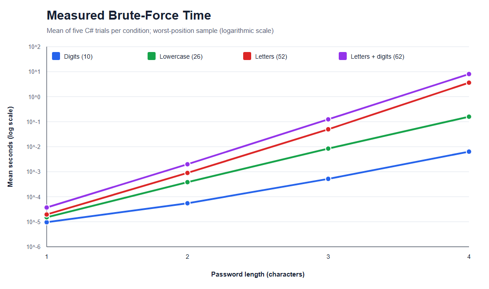
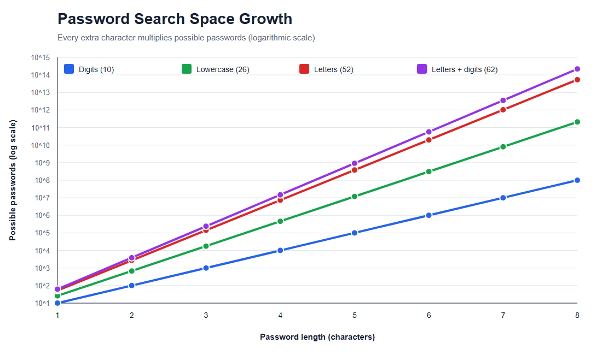
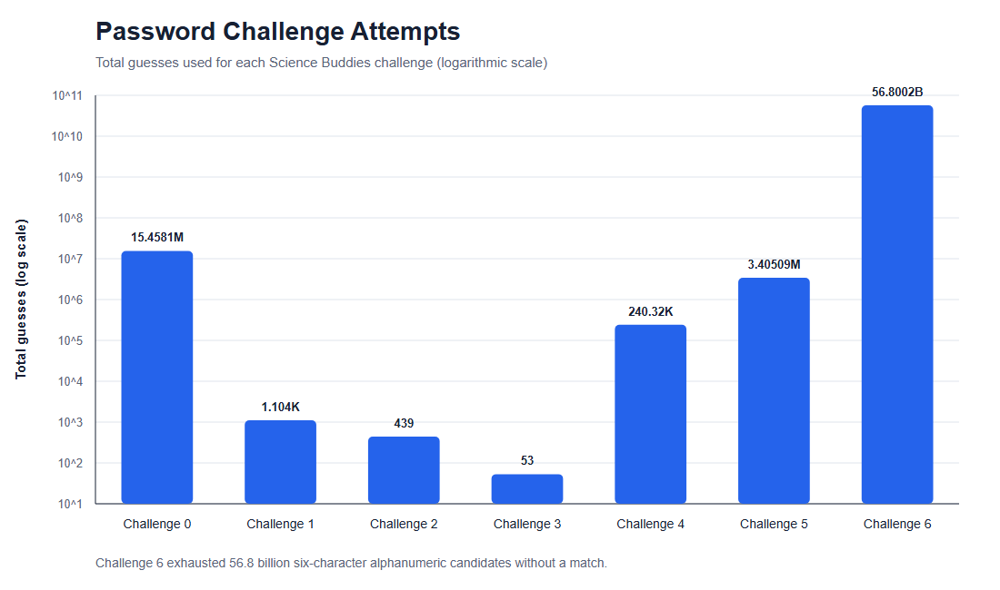
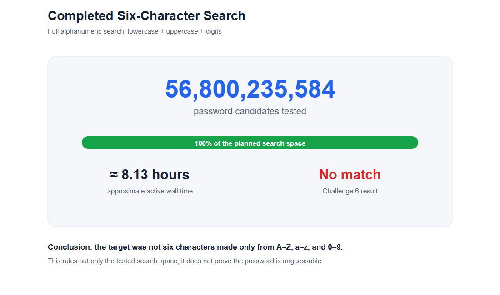

# Password Security: How Do Length, Character Set, and Guessing Method Affect Cracking Difficulty?

**Student:** [Add your name]  
**School/Class:** [Add your school or class]  
**Date:** October 2026

## Abstract

I tested how password length, available characters, and guessing
strategy affect the effort required to recover classroom sample passwords. A
C# program generated guesses locally, hashed each guess with MD5, and compared
the result with authorized Science Buddies sample hashes. Controlled
brute-force trials tested four character sets and lengths one through four,
with five repetitions per condition. Dictionary and word-pair attacks were
also tested. Six of seven Science Buddies challenges were recovered. The final
challenge was tested against every possible six-character password made from
lowercase letters, uppercase letters, and digits: 56,800,235,584 candidates.
The search finished without a match. Results showed exponential growth: adding
one character multiplied the search space by the alphabet size. Predictable
words could be recovered in very few guesses, while short random-looking
passwords required millions or billions. The hypothesis was supported:
increasing length and reducing predictability increased resistance to the
tested attacks. These results apply to a fast educational MD5 comparison and
do not represent attempts against real accounts or modern password storage.

## Research Question

How do password length, character-set size, and guessing method affect the
number of guesses and amount of time required to recover a password?

## Objective

I wanted to find out which kinds of passwords were easiest and hardest for my
program to guess. I compared brute force with dictionary-based strategies and
looked at how the results changed when passwords became longer.

## Hypothesis

I predicted that if password length or the number of allowed characters increases, the
number of possible passwords and the time required for brute force will
increase exponentially. Dictionary attacks will recover predictable words in
fewer guesses than brute force, but they will fail when the target is absent
from the dictionary and its generated combinations.

## Background Research

### Search-space mathematics

If an alphabet contains A possible characters and a password has length L,
there are A^L possible fixed-length passwords. A four-digit PIN has 10^4 =
10,000 possibilities. A four-character password made from lowercase letters,
uppercase letters, and digits has 62^4 = 14,776,336 possibilities. Each added
character multiplies the search space by A, producing an exponential curve.

### Guessing methods

- **Brute force** tests every candidate in a defined search space.
- **Dictionary attacks** test common words and passwords before unusual strings.
- **Word-pair attacks** join words with capitalization, numbers, or separators.
- **Pattern attacks** test likely human choices instead of every possible string.

A long password can still be guessed quickly if it follows a predictable
pattern. A short random password can resist a small dictionary but remains
vulnerable to a sufficiently large exhaustive search.

### Hashing

Websites should not store readable passwords. They store values produced by
password-hashing systems and compare a new login attempt with the stored
result. This project used fast, unsalted MD5 only because that algorithm was
used in the supplied classroom challenge. MD5 is unsuitable for modern
password storage. Modern services should use salted password-hashing schemes
and rate limiting.

Current NIST guidance emphasizes password length, blocking common or
compromised passwords, permitting long passphrases, and limiting failed login
attempts. The experiment measures offline guessing against sample hashes, so
its speed does not represent an online login page.

## Variables

| Type | Variable |
|---|---|
| Independent | Password length: one through four characters in measured trials |
| Independent | Character set: digits, lowercase, mixed-case letters, or letters plus digits |
| Independent | Guessing method: brute force, dictionary, word pairs, and expanded patterns |
| Dependent | Number of guesses |
| Dependent | Elapsed search time |
| Dependent | Whether the password was recovered |
| Controlled | Same computer and C#/.NET program |
| Controlled | Same MD5 comparison method |
| Controlled | Same enumeration order for repeated conditions |
| Controlled | Five repetitions and a 15,000,000-guess limit in the baseline experiment |

## Materials

- Windows computer
- .NET 10 SDK and C# source code
- Science Buddies sample password hashes and supplied word list
- Local CSV result files
- Spreadsheet software for tables and graphs
- Lab notes and process logs

## Safety and Ethics

Only authorized classroom sample hashes and synthetic test passwords were used.
The program never signed in to a website, contacted an account, or accessed
another person's information. No real personal passwords were collected.
Testing real accounts without permission would be unethical and potentially
illegal. Any future test involving human subjects would require teacher or
science-fair approval and careful handling of private information.

## Experimental Procedure

1. I downloaded the Science Buddies starter files and preserved them in an original
   folder for attribution.
2. I wrote a C# program that generates candidate strings, hashes each candidate
   with MD5, compares the bytes with a target hash, counts guesses, measures
   elapsed time, and exports CSV files.
3. I ran self-tests to confirm the enumeration order, expected guess counts, and
   safe import of the supplied challenge data.
4. I defined four brute-force alphabets: 10 digits, 26 lowercase letters, 52
   mixed-case letters, and 62 letters plus digits.
5. For each alphabet, I tested lengths one through four. I placed the synthetic target
   last in the enumeration order to measure a consistent worst case.
6. I repeated each measured condition five times and recorded guesses, mean time,
   minimum time, and maximum time.
7. I tested dictionary and word-pair strategies against predictable and
   random-looking synthetic samples.
8. I ran the program against Science Buddies Challenges 0–6 and recorded every method,
   status, guess count, and elapsed time.
9. For Challenge 6, I tested additional capitalization, word combinations,
   substitutions, separators, printable ASCII patterns, and other defined
   spaces.
10. I ran a resumable search of all 62^6 six-character alphanumeric candidates.
    I saved progress every one million guesses so an interruption did not erase
    the completed work.
11. I exported the measurements to CSV, calculated summary statistics, and graphed
    the results using logarithmic vertical axes.

## Results

### Selected brute-force measurements

| Alphabet | Size | Length | Candidates/guesses | Mean time |
|---|---:|---:|---:|---:|
| Digits | 10 | 4 | 10,000 | 0.006347 s |
| Lowercase | 26 | 4 | 456,976 | 0.158177 s |
| Letters | 52 | 4 | 7,311,616 | 3.633987 s |
| Letters + digits | 62 | 4 | 14,776,336 | 8.026581 s |

The 62-character, length-four condition contained about 1,478 times as many
candidates as the four-digit condition and took about 1,265 times as long on
this computer. Differences between these ratios are expected because short
timings are affected by .NET warmup, operating-system scheduling, and other
background work.

### Search-space growth

For the 62-character alphabet, increasing length from one to four multiplied
the search space by 238,328. Measured time increased by about 216,817 times,
showing the same rapid overall pattern.

### Science Buddies challenges

| Challenge | Result | Successful method | Successful guesses | Total guesses in recorded run |
|---|---|---|---:|---:|
| 0 | Found | Alphanumeric brute force | 446,083 | 15,458,063 |
| 1 | Found | Numeric brute force | 234 | 1,104 |
| 2 | Found | Dictionary | 439 | 439 |
| 3 | Found | Dictionary | 53 | 53 |
| 4 | Found | Word pairs | 228,340 | 240,320 |
| 5 | Found | Word pairs | 3,393,105 | 3,405,085 |
| 6 | Not found | Complete six-character alphanumeric search | — | 56,800,235,584 |

Dictionary attacks recovered Challenges 2 and 3 in fewer than 500 guesses.
Word-pair methods recovered longer Challenges 4 and 5 without testing the much
larger space of every possible string of those lengths. This demonstrates that
predictability can matter as much as raw length.

### Completed Challenge 6 search

The program tested every six-character string made from lowercase letters,
uppercase letters, and digits. All 56,800,235,584 candidates were exhausted
without a matching hash. The two active process-log intervals totaled about
8.13 hours, producing an approximate average of 1.94 million guesses per
second. This rules out that specific length and alphabet; it does not reveal
the actual password or prove that it is impossible to guess.

## Analysis

My results support exponential search-space growth. A fixed-length brute-force
search requires A^L candidates in the worst case, so increasing length has a
larger effect than a simple linear increase. Larger alphabets also increase the
space, although predictable composition rules do not guarantee a strong
human-chosen password.

The method comparisons show why attackers prioritize likely choices. A
dictionary found some supplied samples almost immediately, while brute force
required millions of candidates for short mixed-character targets. The
unsolved challenge demonstrates the limit of negative results: finishing one
large search space proves only that the target is not inside that space.

## Conclusion

My hypothesis was supported. Longer passwords and larger search spaces
required dramatically more guesses and more time in the controlled
brute-force experiment. Dictionary and word-pair attacks were much more
efficient when the target followed a predictable human pattern. Six of seven
Science Buddies challenges were recovered. Challenge 6 remained unsolved even
after a complete 56.8-billion-candidate alphanumeric search.

The practical lesson is that password length and unpredictability both matter.
A longer passphrase that is not common or personally obvious is more resistant
to the tested guessing strategies than a short password or a common dictionary
word. Real security also depends on unique passwords, password managers,
multi-factor authentication, secure salted storage, and login rate limiting.

## Limitations

- The experiment used fast unsalted MD5 because it matched the classroom files.
- Timing results came from one computer and will differ on other hardware.
- Minesweeper training created background CPU load during portions of testing.
- Five repetitions reduce random noise but do not eliminate it.
- Very small durations are especially affected by timer resolution and warmup.
- Synthetic brute-force targets were placed last to create a consistent worst case.
- The word list contained 435 entries and cannot represent every human choice.
- The 8.13-hour final runtime is approximate wall time from two log intervals.
- Offline hash guessing is much faster than a rate-limited online login system.

## Improvements and Further Research

- Repeat the experiment on multiple computers.
- Run more timing repetitions after a dedicated warmup.
- Compare MD5 with a modern slow password-hashing algorithm.
- Compare random passwords, common passwords, and multi-word passphrases.
- Expand and document dictionaries while keeping the experiment ethical.
- Measure energy use or guesses per watt in addition to time.
- Test how rate limiting changes online-attack estimates without attacking a real service.

## Acknowledgments and Attribution

The project idea, sample Python program, sample hashes, and password list came
from Science Buddies. I wrote the C# version for this experiment and checked the
graphs and numerical conclusions against the saved result files.

## Bibliography

1. Science Buddies. “Password Security: How Easily Can Your Password Be
   Hacked?” Accessed October 18, 2026.
   https://www.sciencebuddies.org/science-fair-projects/project-ideas/CompSci_p046/computer-science/password-security-how-easily-can-your-password-be-hacked
2. National Institute of Standards and Technology. *Digital Identity
   Guidelines: Authentication and Lifecycle Management*, SP 800-63B-4, 2025.
   https://pages.nist.gov/800-63-4/sp800-63b.html
3. Rivest, Ronald. *The MD5 Message-Digest Algorithm*, RFC 1321, 1992.
   https://www.rfc-editor.org/rfc/rfc1321
4. Microsoft. “MD5 Class (.NET).” Accessed October 18, 2026.
   https://learn.microsoft.com/dotnet/api/system.security.cryptography.md5

## Files Submitted with the Report

- Password-Security-Final.xlsx — formatted spreadsheet and charts
- results/final/*.png — poster-ready graph images
- results/baseline/measurements.csv — raw repeated-trial data
- results/baseline/summary.csv — calculated timing summaries
- Program.cs, Challenges.cs, and ResumeSearch.cs — commented C# source
